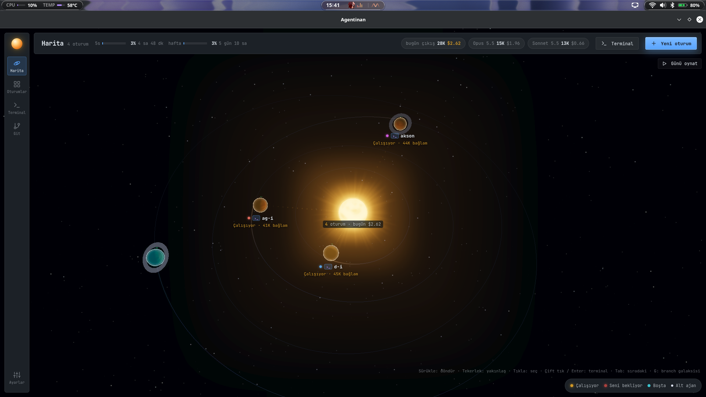
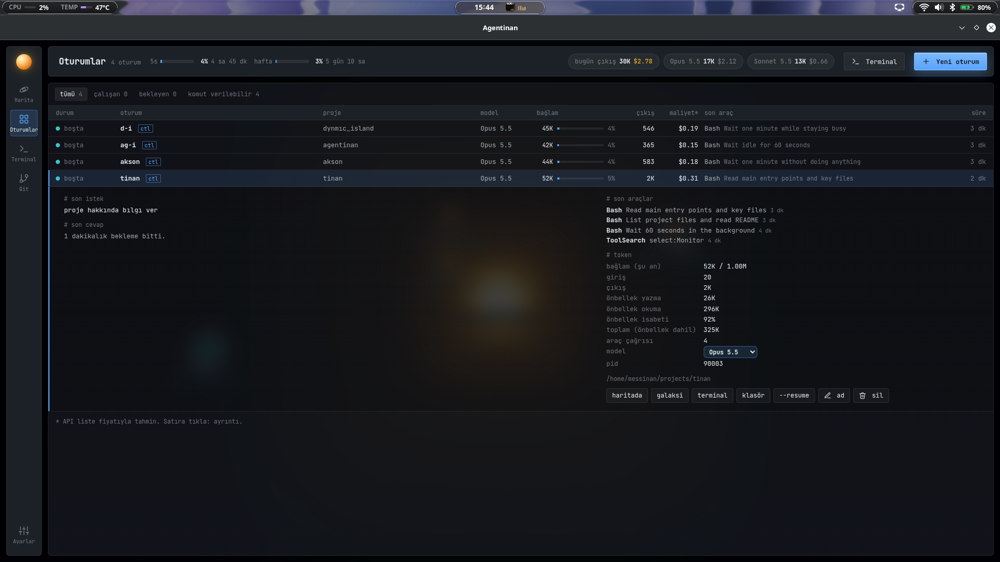
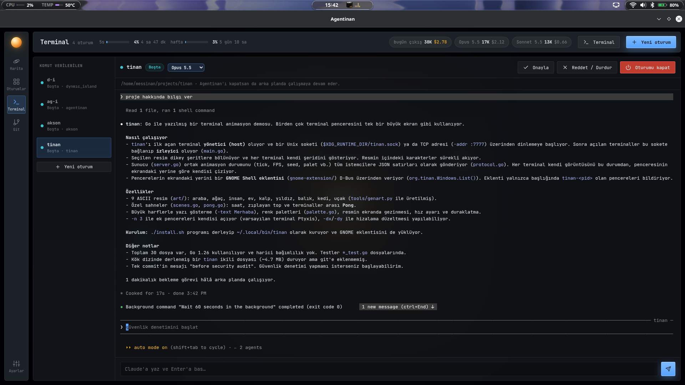
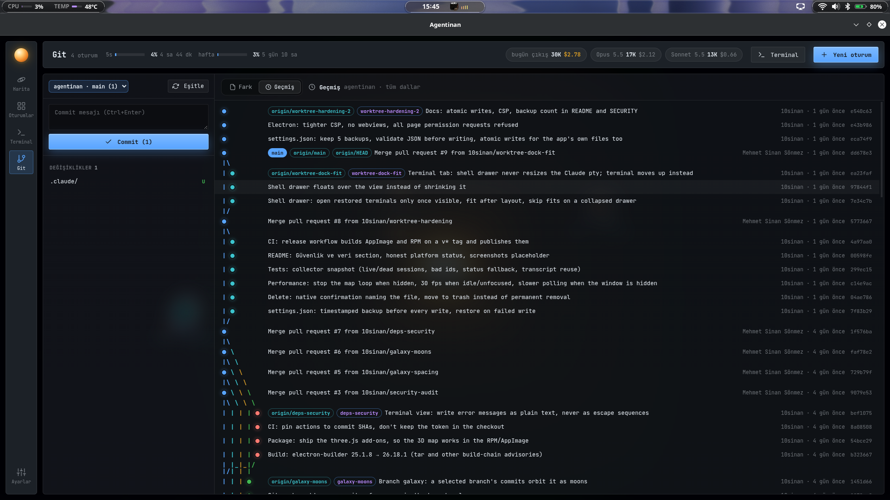

# Agentinan

**Linux** için küçük bir Claude Code panosu. Çalışan her Claude Code oturumunu bir yörünge haritasında gösterir.
Bir oturum onay ya da cevap beklediğinde, ya da işini bitirdiğinde masaüstü bildirimi gönderir.
[Orbiterm](https://github.com/atalaykarahan/orbiterm) fikrinden esinlenildi, ama kod sıfırdan yazıldı.

Arayüz beş sekmeden oluşur: **Harita**, **Oturumlar**, **Terminal**, **Git** ve **Ayarlar**. Her yerde JetBrains Mono kullanılır; paneller haritanın üzerinde yüzen buzlu cam görünümündedir. Oturumlar sekmesi `htop` benzeri bir tablodur.

- **Yörünge haritası:** Ortadaki güneş sizsiniz, her oturum bir gezegen.
  - Turuncu: çalışıyor (arkasında kuyruk izi bırakır).
  - Kırmızı ve nabız gibi atan: sizi bekliyor.
  - Mavi: boşta.
  - Etrafında dönen aylar: çalışan alt ajanlar.
  - Gezegenden uçuşan yazılar: o anda yapılan araç çağrıları.
  - Sürükle-bırak: bir gezegeni **güneşe** bırakırsanız *Durdur* (Claude'a Esc) ya da *Oturumu kapat* seçenekleri çıkar. **Başka bir gezegene** bırakırsanız ilk oturumun son cevabı ikincisine komut olarak gönderilmek üzere bir pencerede açılır; göndermeden önce düzenleyebilirsiniz. Hiçbir şey onaysız yapılmaz; dışarıdan açılan oturumlarda bu düğmeler pasiftir. Sürüklerken bırakılacak yer (güneş ya da gezegen) parlar.
  - Bağlantılar: aynı klasörde çalışan oturumlar arasında projenin renginde ince bir ışık hattı olur; çalışan gezegenlere güneşten enerji ışını akar. İki oturum son 15 dakikada aynı dosyaya yazdıysa aralarında kırmızı, yanıp sönen bir hat ve "olası çakışma" etiketi çıkar (aynı dosyanın farklı worktree'lerdeki kopyaları çakışma sayılmaz).
  - Gezegenler birbirini hafifçe iter ve çeker; çalışan gezegen güneşe doğru hafifçe eğilir, güneşe fazla yaklaşan geri savrulur. Bir gezegeni fareyle tutup sürükleyebilirsiniz; bırakınca yaylanarak yörüngesine döner. Bu sadece görseldir, oturumlara dokunmaz. Düşük kalitede gezegenlerin birbirine etkisi kapanır, sürükleme çalışır.
  - Aynı klasördeki oturumlar aynı rengi paylaşır: gezegenin yüzeyi o renge hafifçe boyanır, etikette de küçük bir renk noktası görünür.
  - Aşırı ısınan gezegenin çevresinden kırmızı şok dalgaları yayılır.
  - Süsler: güneşte korona ışınları, gezegenlerde atmosfer parıltısı, çevrede toz diski, arada bir kayan yıldız ve gezegenin arkasında solan yörünge çizgisi. **Ayarlar → Harita kalitesi → Düşük** seçilince korona, atmosfer, toz diski ve kayan yıldızlar kapanır.
- **Oturum listesi:** Son isteğiniz, son araç çağrıları, token, tahmini maliyet, bağlam doluluğu ve alt ajanlar.
  Bir karta tıklarsanız Claude'un son cevabı açılır. Oradan klasörü açabilir ya da `claude --resume` komutunu kopyalayabilirsiniz.
- **Bugünün toplamı:** Kapanmış oturumlar da dahil, model bazında token ve maliyet.
- **Komut verme:** Üst çubuktaki **Yeni oturum** ile bir klasörde Claude başlatırsınız. **Terminal** sekmesinde o oturumun terminali ve bir komut kutusu açılır; haritada bu oturumlar `›_` işaretiyle görünür. Oradan Claude'a yazabilir, onay sorularını **✓ Onayla** ya da **✕ Reddet / Durdur** ile cevaplayabilirsiniz.
  Haritada bir gezegene tıklayınca açılan kartta da bir komut kutusu vardır; yazdığınız komut doğrudan o oturuma gider (Agentinan'dan başlatılan oturumlar için).
- **Model:** Her oturumun kullandığı Claude modeli harita kartında, Oturumlar'daki ayrıntı panelinde ve Terminal sekmesinin başlığında görünür. Agentinan'dan başlatılan oturumlarda bu bir menüdür: seçince oturuma `/model` komutu gönderilir. Dışarıdan açılan oturumlarda sadece gösterilir.
- **Terminal çekmecesi:** Pencerenin altında, `Ctrl+Q` ya da üst çubuktaki **Terminal** düğmesiyle açılıp kapanan sıradan bir terminal. Projeleri çalıştırmak için (sunucu, test…); seçili oturumun klasöründe açılır, birden çok sekme olur ve çekmece kapalıyken de çalışmaya devam eder. Üst kenarından sürükleyerek boyu ayarlanır.
- **Sohbet adı ve silme:** Harita kartındaki ✎ ya da Oturumlar'daki ayrıntı panelinden sohbetin adını değiştirebilirsiniz; ad Claude Code'un kendi sohbet listesinde (`/resume`) de görünür. **Sil** düğmesi iki kez basılınca oturumu kapatır ve sohbeti (`~/.claude/projects` altındaki dosyasını) kalıcı olarak siler.
  Bu oturumlar Claude Code'un arka plan oturumlarıdır (`claude --bg`). Agentinan kapansa da çalışmaya devam ederler ve tekrar açınca yeniden bağlanılır.
  Daha önce hiç onaylanmamış bir klasör seçerseniz Claude'un "bu klasöre güveniyor musun" sorusu terminalde çıkar. Böyle bir oturum Agentinan kapanınca kapanır.
  VS Code'da ya da başka bir terminalde açılan oturumlar sadece izlenir; onlara dışarıdan komut gönderilemez.
- **Git:** Oturumlarınızın çalıştığı git depoları kendiliğinden listelenir; başka bir depoyu **Depo ekle** ile ekleyebilirsiniz. Değişen dosyaları ve farklarını görür, dosyaları commit'e hazırlar ya da çıkarır, commit atarsınız. **Geçmiş** görünümü tüm dalları bir grafikle gösterir; bir commit'e tıklayınca içeriği açılır. Pull (sadece ileri sarma) ve Push düğmeleri de buradadır.
- **Temalar:** Ayarlar sekmesinde 12 tema var: Agentinan, Dracula, Tokyo Night, Catppuccin Mocha, Nord, Gruvbox, One Dark, Rosé Pine, Solarized Dark, Monokai, Synthwave '84 ve GitHub Dark. Tema arayüzü, terminal renklerini, 3D haritanın arka planını ve gezegen renklerini birlikte değiştirir.
- **Zorlanma uyarısı:** Bir Claude Code oturumunun başlattığı bir işlem (test, sunucu, derleme…) uzun süre bir işlemci çekirdeğinin neredeyse tamamını (varsayılan: %90, 15 saniye) ya da belleğin büyük kısmını (varsayılan: %30) kullanırsa tüm pencerenin kenarlarında kırmızı ışık yanıp söner, sağ altta küçük bir kart çıkar ve masaüstü bildirimi gelir. O oturumun gezegeni haritada aşırı ısınır: titrer, kızarır ve kıvılcım saçar. Karttan işlemi durdurabilir ya da o programı yok sayabilirsiniz. Oturumlarla ilgisi olmayan programlar uyarı vermez. Sınırlar Ayarlar'dan değiştirilebilir.
- **Kullanım limitleri:** Pro / Max planının 5 saatlik ve haftalık limitinin ne kadarının kullanıldığı ve ne zaman sıfırlanacağı üst çubukta görünür; %80 ve %95'te bildirim gelir. Açmak için **Ayarlar → Kullanım limitleri → Etkinleştir**'e basın: Agentinan `~/.claude/settings.json` dosyasına (yedeğini alarak) bir `statusLine` ekler. Limitler, terminalde çalışan bir Claude Code oturumu istek yaptıkça güncellenir. Ayarlar'dan kaldırılınca eski hali geri gelir.
- **Bildirimler:** "Seni beklediğinde bildir" ve "Bitirdiğinde bildir" ayarları **Ayarlar** sekmesinde. "Bitti" bildirimi, pencere öndeyken gönderilmez.

## Ekran görüntüleri

<!-- Görüntüleri docs/screenshots/ altına koyun ve aşağıdaki satırların yorumunu kaldırın. -->
<!--  -->
<!--  -->
<!--  -->
<!--  -->

_Ekran görüntüleri yakında eklenecek._

## Gereksinimler

- **Linux.** Yalnızca **Fedora 44, GNOME, Wayland** üzerinde test edildi. Diğer dağıtımlar, X11 oturumları ve diğer masaüstü ortamları test edilmedi; çalışması beklenir ama garanti edilmez. macOS ve Windows desteklenmez (`/proc` kullanılır).
- Node.js 20 veya üstü
- [Claude Code](https://code.claude.com) kurulu ve hesabınızla giriş yapılmış olmalı (Pro, Max ya da API anahtarı)

## Kurulum

[Sürümler](https://github.com/10sinan/agentinan/releases) sayfasından indirin:

- **AppImage** (her dağıtımda çalışır):
  ```sh
  chmod +x Agentinan-*-x86_64.AppImage
  ./Agentinan-*-x86_64.AppImage
  ```
- **RPM** (Fedora / RHEL / openSUSE):
  ```sh
  sudo dnf install ./agentinan-*.x86_64.rpm
  ```
  Kurulumdan sonra uygulamalar menüsünde **Agentinan** olarak çıkar.

Claude Code'un kurulu ve hesabınızla giriş yapılmış olması gerekir.

## Çalıştırma

```sh
npm install
npm start
npm run dist           # paketler: dist/ altında AppImage ve RPM
./install-desktop.sh   # isteğe bağlı: uygulamalar menüsüne ekler
sh scripts/make-icon.sh  # ikonu build/icon-source.png çiziminden yeniden üretir (ImageMagick gerekir)
```

`node scripts/check.js` Electron açmadan tek bir anlık görüntü yazdırır. Gerçek `~/.claude` verisini elle kontrol etmek için kullanılır.

## Testler

```sh
npm test
```

Node'un yerleşik `node:test`'i kullanılır, ek bağımlılık yoktur. Testler fiyat hesabını, transcript ayrıştırmayı, plan limitlerinin `settings.json` üzerindeki ekle / kaldır döngüsünü ve `Git` sınıfını (geçici depolar ve sahte bir uzak depo üzerinde) kapsar. Hepsi geçici klasörlerde çalışır; gerçek `~/.claude` dosyalarına ve depolarınıza dokunmaz. Arayüz ve Electron penceresi testlerin kapsamı dışındadır. Her push ve pull request'te GitHub Actions aynı testleri çalıştırır.

## Güvenlik ve veri

**Okuduğu dosyalar** (yalnızca okur):

| Dosya | Neden |
| --- | --- |
| `~/.claude/sessions/*.json` | Çalışan oturumlar ve durumları |
| `~/.claude/projects/**/*.jsonl` | Sohbet kayıtları: token, maliyet, araç çağrıları |
| `~/.claude.json` | Bir klasörün "güvenilir" olup olmadığı (yeni oturum başlatırken) |
| `/proc/<pid>/*` | Süreç var mı, bilgisayarı yoran süreç var mı |

(`CLAUDE_CONFIG_DIR` ayarlıysa `~/.claude` yerine o klasör kullanılır.)

**Yazdığı dosyalar:**

| Dosya | Ne zaman |
| --- | --- |
| `~/.config/agentinan/` (`settings.json`, `own-sessions.json`, `shells.json`) | Kendi ayarları ve yeniden açılacak oturumlar |
| `~/.config/agentinan/limits.json`, `statusline.sh`, `statusline-next` | Yalnızca "Kullanım limitleri" açıksa |
| `~/.claude/settings.json` | Yalnızca **Kullanım limitleri**'ni siz açar ya da kapatırsanız: `statusLine` alanı eklenir / eski haline döner, diğer alanlara dokunulmaz |
| `~/.claude/projects/.../<oturum>.jsonl` | **Ad değiştir**: dosyanın sonuna bir başlık satırı eklenir |

**Yedek:** `~/.claude/settings.json` her değişmeden önce aynı klasöre `settings.json.bak-<zaman damgası>` olarak kopyalanır (son 5 yedek tutulur). Yazma başarısız olursa önceki içerik otomatik geri yüklenir. Dosya geçerli JSON değilse hiç dokunulmaz. Elle geri dönmek için: `cp ~/.claude/settings.json.bak-<zaman damgası> ~/.claude/settings.json`.

**Silme:** **Sil** düğmesi önce uygulamanın kendi onay penceresini gösterir (dosya adı ve alt-ajan kaydı sayısıyla). Onaylarsanız oturum kapatılır ve sohbet dosyası ile alt-ajan klasörü **çöp kutusuna** taşınır; kalıcı olarak silinmez. Çöp kutusu kullanılamıyorsa hiçbir şey silinmez ve hata gösterilir.

**Komutlar:** Dışarıda çalıştırılan her şey (`claude`, `git`) argüman dizisiyle başlatılır, hiçbir zaman kabuk komutu olarak birleştirilmez; oturum ve iş kimlikleri `[A-Za-z0-9_-]` ile doğrulanır. Ayrıntılar için [SECURITY.md](SECURITY.md).

## Nasıl çalışır

Veriyi `~/.claude` altındaki dosyalardan okur (`CLAUDE_CONFIG_DIR` ayarlıysa oradakilerden). Ağa kendisi bağlanmaz.
Dışarıya dokunduğu yerler sadece sizin açtığınız özelliklerdir:

- **Kullanım limitleri** açılırsa `~/.claude/settings.json` dosyasına bir `statusLine` ekler (yazmadan önce yedek alınır, ayrıntılar aşağıda).
- **Git sekmesi** commit, push, pull ve fetch yapar; bunlar `git` programını çalıştırır, push / pull / fetch ağa bağlanır.
- **Yeni oturum** Claude Code başlatır.
- **Ad değiştirme** sohbet dosyasının sonuna bir başlık kaydı ekler; **Sil**, onay istedikten sonra sohbet dosyasını çöp kutusuna taşır.

- `sessions/<pid>.json`: Çalışan her Claude Code süreci için bir dosya. Klasörü ve durumu (`busy` / `idle` / `waiting`) tutar.
  Süreç gerçekten çalışıyor mu diye `/proc/<pid>/stat` dosyasındaki başlangıç zamanıyla karşılaştırılır.
- `projects/<klasör>/<oturum>.jsonl`: Oturumun kaydı (transcript). Yalnızca yeni eklenen satırlar okunur.
- `projects/<klasör>/<oturum>/subagents/`: Alt ajanların kayıtları ve `.meta.json` dosyaları.

Maliyet, API liste fiyatlarıyla hesaplanan bir tahmindir ([src/pricing.js](src/pricing.js)).
Pro ya da Max aboneliğinde bu tutarı ödemezsiniz.

## Dosyalar

| Dosya | Görevi |
| --- | --- |
| [src/collector.js](src/collector.js) | `~/.claude` dosyalarını okur ve anlık görüntüyü hazırlar |
| [src/pricing.js](src/pricing.js) | Model fiyatları ve maliyet hesabı |
| [src/terminals.js](src/terminals.js) | Agentinan'dan başlatılan oturumları açar, bağlanır, komut gönderir |
| [renderer/console.js](renderer/console.js) | Terminal paneli, komut kutusu ve "Yeni oturum" penceresi |
| [src/git.js](src/git.js) | Git komutları: durum, fark, stage, commit, geçmiş, push / pull |
| [renderer/git.js](renderer/git.js) | Git sekmesi |
| [renderer/themes.js](renderer/themes.js) | Tema renkleri; yeni bir tema eklemek için listeye bir giriş eklemek yeter |
| [src/monitor.js](src/monitor.js) | `/proc`'tan bilgisayarı yoran işlemleri bulur ve hangi oturuma ait olduklarını çıkarır |
| [renderer/hog.js](renderer/hog.js) | Zorlanma uyarısı: pencere boyu kırmızı ışık, köşedeki kart, durdur / yok say |
| [src/limits.js](src/limits.js) | Plan limitleri: status line betiği, ayara ekleme / kaldırma, okuma |
| [test/](test) | Birim ve entegrasyon testleri (`npm test`) |
| [src/main.js](src/main.js) | Electron penceresi, okuma (pencere açıkken 1,5 sn, gizliyken 5 sn), bildirimler, ayarlar |
| [renderer/app.js](renderer/app.js) | Sekmeler, oturum kartları, harita bilgi kartı ve ayarlar |
| [renderer/orbit3d.js](renderer/orbit3d.js) | 3D yörünge haritası (three.js) |

## Lisans

[MIT](LICENSE)
